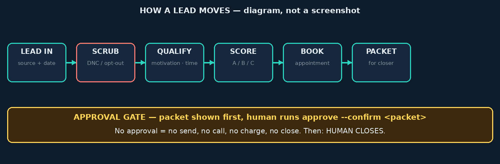
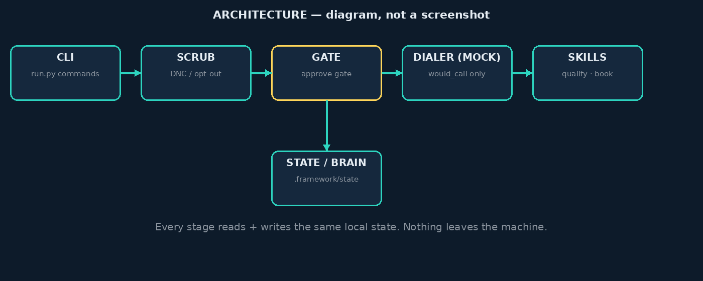
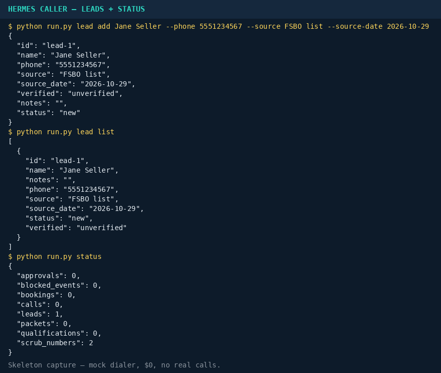
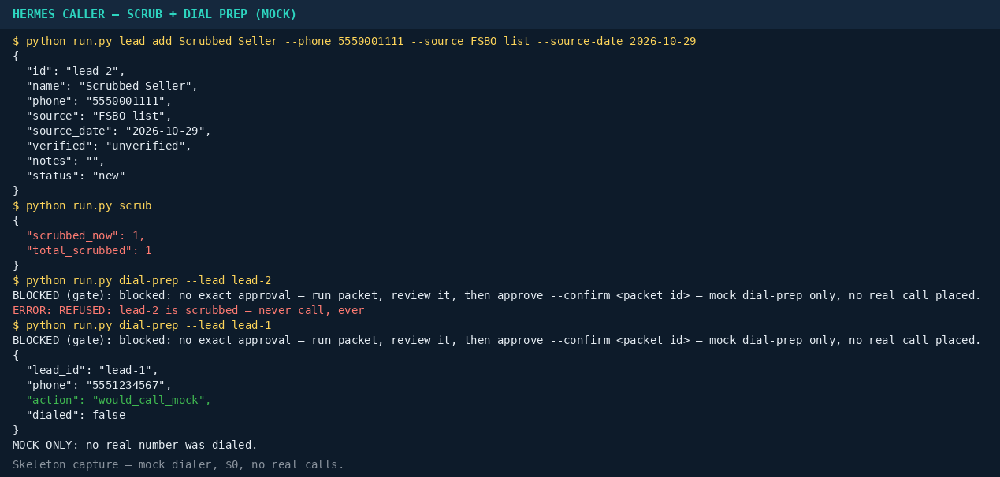
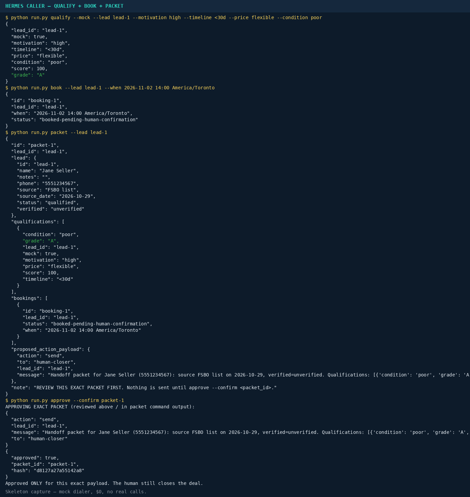

# Hermes Caller — Agent Phone / Cold-Caller Framework


<p align="center">
  
</p>

<p align="center">
  
</p>

## Wholesale mode — NEW (Dier workflow model, not Dier himself)

`python3 run.py wholesale --lead lead-1 --mock --motivation high --timeline "<30d" --authority owner --price 200000 --repairs 30000 --arv 300000 --fee 10000`
→ verdict DEAL, buyer profit $60,000, open math in the packet. `python3 run.py wholesale-script --part probate` prints the respectful probate script.

Wholesale is NOT generic sales: seller leads, not buyer leads. Qualification = motivation + timeline + authority + open deal math. Probate without confirmed trustee/executor = HOLD-probate, no offer pitch, ever. Assignment fee is disclosed in the packet, never hidden. Ontario: assignment model needs a lawyer / RECO check before use. This is a style/workflow model in Kevin's own name — never presented as Maximilian Dier or Assigns, never his results, never harvested numbers.

## v1.0 — PRODUCTION READY (code, not deployed service)

`python3 run.py doctor` → personas, scrub file, env presence (never values), receipts chain, real-call ready yes/no.
`python3 run.py model-qualify --lead lead-1 --provider openrouter --notes "seller wants cash in 30 days, owns outright"` → real LLM JSON, validated, never silently mock.
`python3 run.py call --lead lead-1 --provider twilio --real --packet packet-1` → real call ONLY if packet exists in state + keys in env + scrub passed.

Production checklist, honest: code is production-grade (validated model output, hash-chained receipts, doctor, .env.example, gate + scrub + packet enforced, no keys in code). Deployment is NOT done until YOU do: provider account + keys in env (Secure Vault, never chat), compliance review, DNC check, your test number first, one approved packet per real call. No real call has been placed by this repo yet.

## Persona library — NEW, elite production grade (6 style packs, 1 core)

`python3 run.py persona list` → wholesale, realtor, agency, local_service, clinic, generic_sales
`python3 run.py persona show --persona realtor` → buyer, pains, language, opening, discovery, objections, close, compliance, forbidden
`python3 run.py persona qualify --persona realtor --lead lead-1 --motivation high --timeline "<30d" --budget-fit good --area-fit good` → DEAL

Same core for all: scrub → qualify → score → packet → human closes. Only the style changes per vertical. Wholesale still uses open deal-math + probate HOLD (see wholesale.py). Clinic is strictest: no patient data, no medical claims, legal review before any live list. No persona impersonates a real person.

## Real phone calls — NEW (adapter built, no real call yet)

`python3 run.py call --lead lead-1 --provider twilio --dry-run` → shows what WOULD be called, dialed: false. Always.
A real call needs ALL of: (1) your own Twilio or Vapi account, (2) keys in env vars only, never in code/chat, (3) an approved packet for that exact lead, (4) scrub passed, (5) your test number first. Then: `python3 run.py call --lead lead-1 --provider twilio --real --packet packet-1`.
No keys = no call, no approved packet = no call, scrubbed = never call. No robocall blasts, no harvested lists, DNC + opt-out respected, compliance review before any live list.

## What this is — is this an agent phone / cold caller?

Yes. Plainly: **this IS an agent-phone / cold-caller framework.**
An agent prepares the dial list, qualifies sellers, scores them,
books appointments, and hands a packet to a human closer — the human
closes the deal. That is the RunItRemote-style job, as a framework
you can hand to Hermes.

Honest limit, right up front: **in this skeleton it is NOT a real
phone dialer.** The dialer is mock only (`would_call_mock`,
`dialed: false`, $0). No real call is placed, no real sale is made.
Real calling needs Twilio/Vapi keys, a DNC API check, a CRM, and a
compliance review first — see "What to add next for real calls" below.

Parallel to Battle Court, built for Hermes: a lead list goes in, scrub
filter runs, qualification scores it, booking is drafted, and a handoff
packet goes to the human closer. The human closes. The agent prepares,
scores, and drafts — autonomously, up to a hard gate.

## Workflow — how a lead moves (diagram, not a screenshot)



1. Lead list in (CSV / `lead add`) — source + source date required
2. Scrub / DNC / opt-out filter — scrubbed numbers are NEVER called
3. Call script — motivation, timeline, price, condition (skills/)
4. Score — A / B / C from answers given, never invented
5. Book appointment — pending human confirmation
6. Handoff packet — for the human closer
7. Follow-up sequence — drafts only, until approved

## Architecture — what talks to what (diagram, not a screenshot)



CLI → Scrub → Gate → Dialer (mock) → Skills, all reading and writing
the same local state (`.framework/state.json`). Nothing leaves the
machine. The gate sits between the packet and any send/call/charge/
close — no approval, no action.

## What "autonomous" means here — honestly

Autonomous: research, dial-list prep, mock qualification, scoring,
drafting outreach/booking messages, preparing a sales packet.
**NOT autonomous: sending an email/SMS, placing a real call, charging,
closing a deal, or deleting data.** Those are blocked by the approval
gate (`framework/gate.py`) until a human reviews the exact packet and
runs `approve --confirm <packet_id>`. That gate is the immutable core.

## Copy-paste start here

**[COPY_PASTE.md](COPY_PASTE.md) — copy that one file into Hermes (or a new repo/chat) and it recreates this whole framework, with the brief, file list, bootstrap script, and first commands. No manual edits needed.**

## Quickstart

```bash
python run.py lead add "Jane Seller" --phone 5551234567 --source "FSBO list" --source-date 2026-10-29
python run.py scrub
python run.py qualify --mock --lead lead-1 --motivation high --timeline "<30d"
python run.py book --lead lead-1 --when "2026-11-02 14:00 America/Toronto"
python run.py packet --lead lead-1
python run.py approve --confirm packet-1
```

## Screenshots — the actual CLI (skeleton, mock, $0, no real calls)

These are real captures of the real CLI running in a clean demo
folder — text output first, rendered to PNG. Regenerate them with
`python3 scripts/capture_screenshots.py`. Branding art is generated
with `python3 scripts/make_assets.py` (PIL only, original art, no
copied logos).

### Leads + status



Text capture: [`docs/screenshots/status-leads.txt`](docs/screenshots/status-leads.txt)

### Scrub + dial-prep (mock refusal for a scrubbed lead)



Text capture: [`docs/screenshots/scrub-dialprep.txt`](docs/screenshots/scrub-dialprep.txt)

### Qualify + book + packet



Text capture: [`docs/screenshots/qualify-book-packet.txt`](docs/screenshots/qualify-book-packet.txt)

## Free stack

Local-first, file-based state, no dependencies, mock dialer ($0).
Models: Ollama local + OpenRouter free tier only (`router.yaml`,
free-only filter — never silently upgrades to paid). Twilio/Vapi are
STUBS only: no keys, no real calls, bring your own keys later.

## Compliance

See COMPLIANCE.md: business hours only, DNC/scrub absolute, opt-out
on first request, identify yourself, no robocalls without consent.
This is not legal advice.

## Honest status — skeleton v0.1.0-skeleton (bottom, not headline)

- Mock dialer only. $0. No real calls, no real sales, no pricing,
  no payment system — none invented.
- No real model runners yet; qualification in the skeleton is mock.
- No Twilio/Vapi wiring, no DNC API, no CRM yet.

## What to add next for real calls

Twilio/Vapi keys (your own env, never committed), a DNC API check,
a CRM connection, a compliance review for your jurisdiction, and a
real Windows / live-call test with consenting test numbers first.
